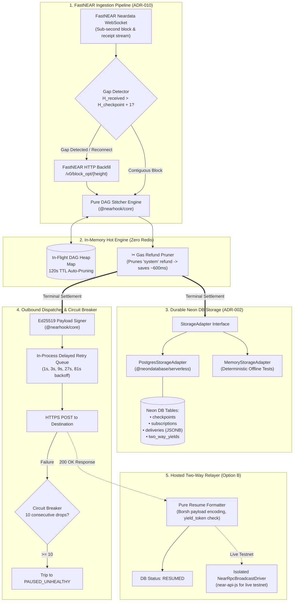

# Ticket 07: FastNEAR Hybrid Ingestion Poller, In-Memory Hot State, and Neon DB Durable Storage

## Overview
Implement the production-grade ingestion and storage engine in `@nearhook/engine`. The engine consumes block and receipt outcomes from FastNEAR Neardata, stitches them in-flight using `@nearhook/core`, persists terminal states to Neon DB (PostgreSQL) as durable JSONB, manages an outbound HTTPS webhook dispatcher with exponential backoff and circuit breaking, and provides the pure domain logic for Two-Way Webhook (`yield_resume`) resumption.

---

## Architectural Decisions (Derived from /grill-me Alignment)

1. **In-Process Hot Memory (No Redis Dependency):**
   - Replaced external Redis with an in-process Node.js heap (`Map<TxHash, InFlightDAG>`) featuring automated 120s TTL eviction.
   - Eliminates Redis hosting costs, removes Docker setup friction, and delivers microsecond in-flight lookups.
   - Memory is strictly bounded: in-flight transactions resolve within 2–4 blocks (~1.2s–2.4s) and are immediately evicted upon settlement and commit to Neon DB.

2. **Durable Storage via Neon DB (`@neondatabase/serverless`) & StorageAdapter Interface:**
   - Production connects to Neon DB using `@neondatabase/serverless` (or standard Postgres pooled connection string).
   - Decoupled behind a strict TypeScript `StorageAdapter` interface:
     - `PostgresStorageAdapter`: Production driver executing raw SQL against Neon DB.
     - `MemoryStorageAdapter`: Zero-dependency, in-memory repository for 100% deterministic, offline unit testing.

3. **Hybrid Ingestion Pipeline with Automated Gap Detection (ADR-010):**
   - **Primary:** FastNEAR Neardata WebSocket feed for sub-second receipt outcome streaming.
   - **Secondary & Backfill:** FastNEAR HTTP REST endpoint (`/v0/block_opt/{height}`).
   - **Gap Invariant:** If received block $H_{\text{current}} > H_{\text{checkpoint}} + 1$ or socket drops, pause real-time ingestion, sequentially fetch missing block range $[H_{\text{checkpoint}} + 1 \dots H_{\text{current}} - 1]$ via HTTP, and resume push only once contiguous.

4. **Outbound Dispatcher with In-Process Delayed Retry & Circuit Breaker (ADR-002):**
   - Outbound HTTPS POST requests sign the payload using `@nearhook/core` Ed25519 relayer key ($M = \tau \parallel "." \parallel \text{JSON}$).
   - Delayed retry queue runs in-process with jittered exponential backoff: `1s, 3s, 9s, 27s, 81s` ($\pm 20\%$ jitter).
   - Circuit breaker: Subscription status automatically transitions to `PAUSED_UNHEALTHY` after 10 consecutive delivery failures (or >95% failures across 50 attempts).

5. **Two-Way Relayer Domain Separation (Option B — Pure Domain Logic, Zero Mocks):**
   - Core relayer logic is pure: Borsh/byte serialization of developer JSON responses (`{"approved": true}`), validation of `yield_token` and contract ID, and DB status transition (`AWAITING_WEBHOOK` -> `RESUMED`).
   - Unit tests exercise 100% real code paths with **zero mocking**.
   - Live transaction submission (`near-api-js` key signing and RPC broadcast) is isolated in a standalone broadcast driver executed only during live Testnet integration testing.

---

## System Architecture



---

## Detailed Database Schema (`schema.sql`)

```sql
-- NearHook Engine Durable Storage Schema (Neon DB / PostgreSQL)

-- 1. Contiguous Block Checkpointing Log
CREATE TABLE IF NOT EXISTS checkpoints (
    id VARCHAR(32) PRIMARY KEY DEFAULT 'fastnear_checkpoint',
    last_block_height BIGINT NOT NULL,
    updated_at TIMESTAMPTZ NOT NULL DEFAULT NOW()
);

-- 2. Subscriptions Table (Routing & Filter Rules)
CREATE TYPE subscription_status AS ENUM ('ACTIVE', 'PAUSED_MANUAL', 'PAUSED_UNHEALTHY');

CREATE TABLE IF NOT EXISTS subscriptions (
    id VARCHAR(64) PRIMARY KEY, -- 'sub_...'
    account_id TEXT NOT NULL,   -- e.g. 'merchant.near', '*.app.near'
    event_types TEXT[] NOT NULL DEFAULT '{"payment.settled"}',
    chain_filter TEXT[] NOT NULL DEFAULT '{}',
    destination_url TEXT NOT NULL,
    agent_safe BOOLEAN NOT NULL DEFAULT FALSE,
    dust_threshold_usd NUMERIC(10, 4) NOT NULL DEFAULT 1.0000,
    status subscription_status NOT NULL DEFAULT 'ACTIVE',
    consecutive_failures INT NOT NULL DEFAULT 0,
    created_at TIMESTAMPTZ NOT NULL DEFAULT NOW(),
    updated_at TIMESTAMPTZ NOT NULL DEFAULT NOW()
);

CREATE INDEX IF NOT EXISTS idx_subscriptions_account ON subscriptions(account_id);
CREATE INDEX IF NOT EXISTS idx_subscriptions_status ON subscriptions(status);

-- 3. Deliveries Table (Immutable Audit Ledger & 1-Click Free Replay)
CREATE TABLE IF NOT EXISTS deliveries (
    id VARCHAR(64) PRIMARY KEY, -- 'evt_...'
    subscription_id VARCHAR(64) NOT NULL REFERENCES subscriptions(id) ON DELETE CASCADE,
    tx_hash VARCHAR(64) NOT NULL,
    block_height BIGINT NOT NULL,
    protocol_status VARCHAR(16) NOT NULL,
    business_status VARCHAR(32) NOT NULL,
    payload JSONB NOT NULL,
    http_status SMALLINT,
    attempt_count SMALLINT NOT NULL DEFAULT 1,
    latency_ms INT,
    response_body TEXT,
    created_at TIMESTAMPTZ NOT NULL DEFAULT NOW(),
    delivered_at TIMESTAMPTZ
);

CREATE INDEX IF NOT EXISTS idx_deliveries_tx_hash ON deliveries(tx_hash);
CREATE INDEX IF NOT EXISTS idx_deliveries_subscription ON deliveries(subscription_id);
CREATE INDEX IF NOT EXISTS idx_deliveries_created_at ON deliveries(created_at DESC);

-- 4. Two-Way Yields Table (Execution State Tracker)
CREATE TYPE yield_execution_status AS ENUM ('AWAITING_WEBHOOK', 'RESUMED', 'EXPIRED');

CREATE TABLE IF NOT EXISTS two_way_yields (
    yield_token VARCHAR(128) PRIMARY KEY,
    tx_hash VARCHAR(64) NOT NULL,
    contract_id TEXT NOT NULL,
    status yield_execution_status NOT NULL DEFAULT 'AWAITING_WEBHOOK',
    resume_payload TEXT,
    resume_tx_hash VARCHAR(64),
    created_at_block BIGINT NOT NULL,
    expires_at_block BIGINT NOT NULL,
    created_at TIMESTAMPTZ NOT NULL DEFAULT NOW(),
    resumed_at TIMESTAMPTZ
);

CREATE INDEX IF NOT EXISTS idx_yields_contract ON two_way_yields(contract_id);
CREATE INDEX IF NOT EXISTS idx_yields_status ON two_way_yields(status);
```

---

## File Map for `@nearhook/engine`

```text
packages/engine/
├── package.json
├── tsconfig.json
├── src/
│   ├── types.ts                     # Engine domain types, interfaces, config definitions
│   ├── storage/
│   │   ├── schema.sql               # Canonical DDL schema migrations
│   │   ├── interface.ts             # StorageAdapter interface definition
│   │   ├── memory.ts                # MemoryStorageAdapter for deterministic unit tests
│   │   └── postgres.ts              # PostgresStorageAdapter (@neondatabase/serverless driver)
│   ├── memory/
│   │   └── in-flight.ts             # InFlightDAGStore (in-process Map with 120s TTL auto-eviction)
│   ├── ingestion/
│   │   ├── gap-detector.ts          # Gap detection logic (H_current vs H_checkpoint)
│   │   ├── backfill.ts              # Sequential HTTP block fetcher (/v0/block_opt/{height})
│   │   └── stream.ts                # StreamWorker coordinating WebSocket push and HTTP backfill
│   ├── dispatcher/
│   │   ├── queue.ts                 # Delayed retry queue with jittered exponential backoff
│   │   └── circuit-breaker.ts       # Consecutive failure tracker and auto-trip logic
│   ├── relayer/
│   │   ├── yield-resume.ts          # Pure domain formatter (payload Borsh encoding, validation)
│   │   └── broadcast-driver.ts      # Standalone near-api-js RPC transaction submission
│   └── index.ts                     # Public API exports
└── test/
    ├── storage.test.ts              # StorageAdapter CRUD & wildcard query tests
    ├── memory.test.ts               # In-flight heap TTL expiration & settlement eviction tests
    ├── gap-detector.test.ts         # Gap detection and sequential backfill range calculation tests
    ├── dispatcher.test.ts           # Exponential backoff scheduling and circuit breaker trip tests
    └── relayer.test.ts              # Pure yield_resume encoding and state transition tests
```

---

## Step-by-Step Implementation Tasks

### Task 1: Package Scaffolding & Configuration
- Create `packages/engine/package.json` with workspace dependencies (`@nearhook/core`), `@neondatabase/serverless`, `ws`, and dev dependencies.
- Create `packages/engine/tsconfig.json` extending root config with composite project reference to `@nearhook/core`.
- Define core engine types in `packages/engine/src/types.ts`.

### Task 2: Storage Layer & Neon DB Adapter
- Create `packages/engine/src/storage/schema.sql` with migrations for all 4 tables.
- Define `StorageAdapter` in `packages/engine/src/storage/interface.ts`.
- Implement `MemoryStorageAdapter` in `packages/engine/src/storage/memory.ts` supporting wildcard account pattern matching (`*.merchant.near`).
- Implement `PostgresStorageAdapter` in `packages/engine/src/storage/postgres.ts` using `@neondatabase/serverless`.
- Test storage operations in `packages/engine/test/storage.test.ts`.

### Task 3: In-Process In-Flight DAG Hot Store
- Implement `InFlightDAGStore` in `packages/engine/src/memory/in-flight.ts`.
- Provide atomic update, retrieval, eviction, and TTL sweep timer (`unref()`).
- Test TTL expiration and immediate settlement eviction in `packages/engine/test/memory.test.ts`.

### Task 4: Ingestion Pipeline with Gap Detection & HTTP Backfill
- Implement `BlockGapDetector` in `packages/engine/src/ingestion/gap-detector.ts`.
- Implement `HttpBlockBackfiller` in `packages/engine/src/ingestion/backfill.ts` fetching blocks sequentially.
- Implement `IngestionStreamWorker` in `packages/engine/src/ingestion/stream.ts` orchestrating WebSocket push, pausing on gaps, executing backfills, and feeding receipts to `@nearhook/core` DAG stitcher.
- Test gap detection and backfill in `packages/engine/test/gap-detector.test.ts`.

### Task 5: Outbound Dispatcher & Circuit Breaker
- Implement `CircuitBreaker` in `packages/engine/src/dispatcher/circuit-breaker.ts`.
- Implement `DelayedRetryQueue` in `packages/engine/src/dispatcher/queue.ts` with exponential backoff (`1s, 3s, 9s, 27s, 81s`).
- Sign payloads using `createWebhookAttestation` from `@nearhook/core`.
- Test retry delays and circuit breaker tripping in `packages/engine/test/dispatcher.test.ts`.

### Task 6: Hosted Two-Way Relayer (Pure Domain Logic)
- Implement `formatYieldResumeAction` and `processWebhookYieldApproval` in `packages/engine/src/relayer/yield-resume.ts`.
- Encode developer JSON into valid Borsh payload bytes and update `two_way_yields` record.
- Isolate `NearRpcBroadcastDriver` in `packages/engine/src/relayer/broadcast-driver.ts`.
- Test pure relayer logic with 0 mocks in `packages/engine/test/relayer.test.ts`.

---

## Acceptance Criteria & Verification

1. **Deterministic Unit Test Suite:**
   - All tests in `packages/engine/test/` run completely offline in <2 seconds.
   - Zero unauthorized mocks: all domain logic, gap detection, retry queues, and storage interfaces run against real code.
2. **Type Safety & Build:**
   - Strict TypeScript compilation with zero errors (`pnpm --filter @nearhook/engine build`).
   - Zero `@ts-ignore` or `any` type casts.
3. **Correctness Invariants Verified:**
   - Checkpoint gap detection correctly identifies skipped blocks and halts push until backfill completes.
   - Subscription wildcards (`*.merchant.near`) properly route incoming receipts.
   - Circuit breaker trips to `PAUSED_UNHEALTHY` precisely on the 10th consecutive delivery drop.
   - Two-Way Webhook developer responses serialize correctly into `yield_resume` action parameters.
