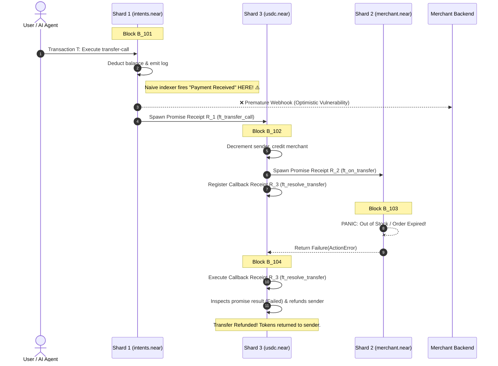
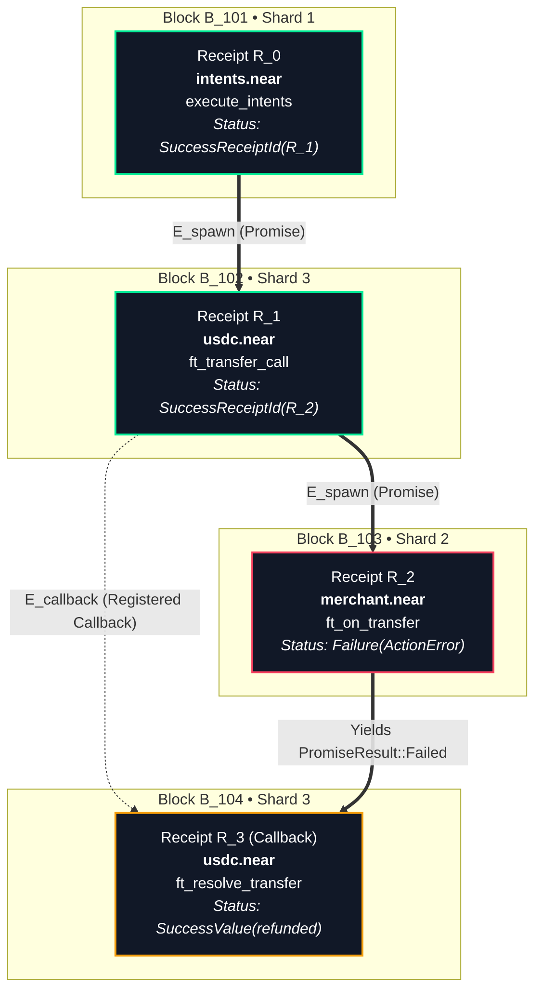
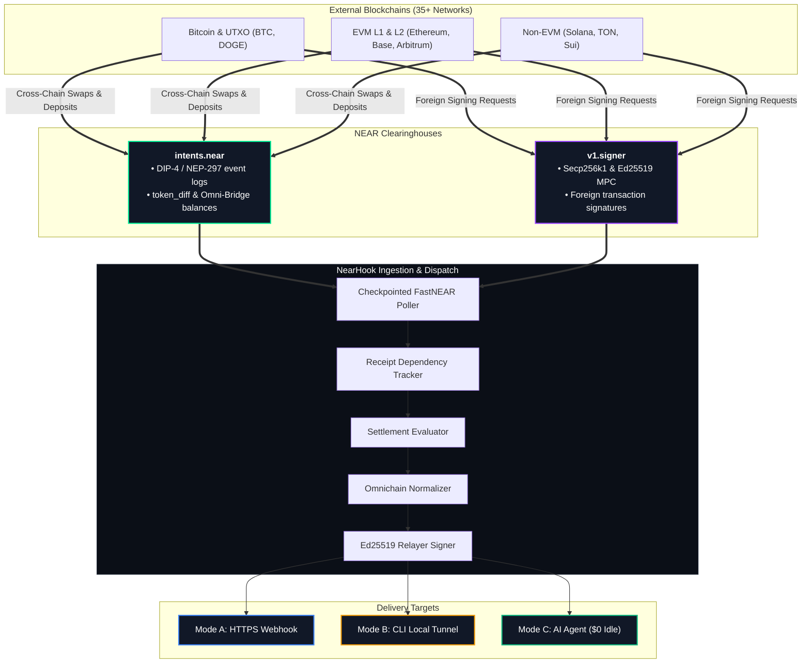
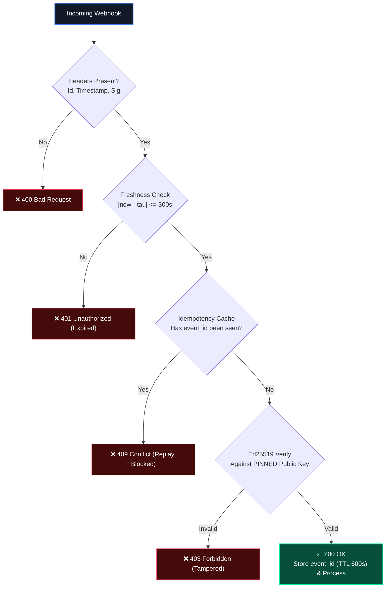
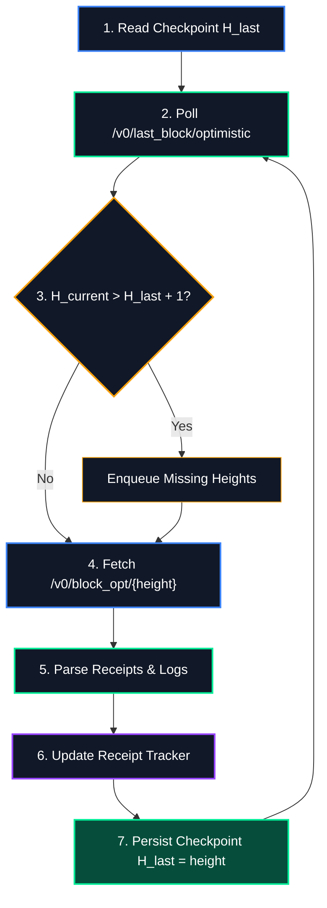
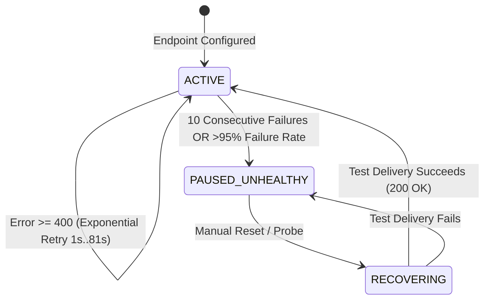
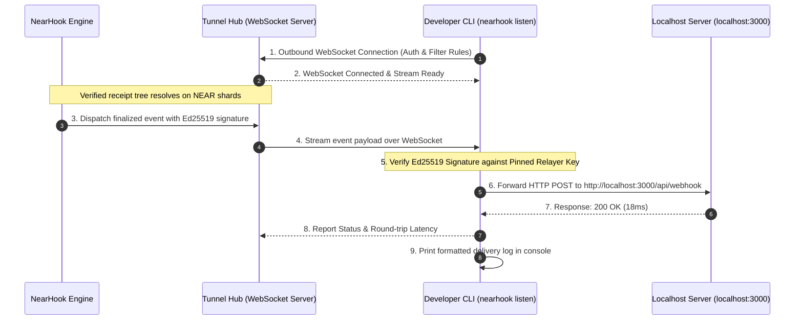

# NearHook: Asynchronous Receipt-Aware Event Delivery & Local Tunneling for NEAR Protocol

**Technical Whitepaper** • Version 2.1 • November 2026  
**Category:** Developer Infrastructure / Event Ingress / NEAR Protocol  

---

## Abstract

Consuming state transitions on NEAR Protocol introduces a fundamental correctness challenge absent in single-block atomic chains: **Nightshade asynchronous sharding**. A single transaction decomposes into a tree of cross-shard execution receipts (`Receipt`) resolving across 2 to 4+ consecutive blocks. Naive indexers triggering callbacks upon root transaction inclusion suffer from **Optimistic Settlement Vulnerabilities**: a parent receipt succeeds at block $B_t$, but a child cross-contract promise panics at block $B_{t+1}$, causing a contract callback to issue a refund at block $B_{t+2}$.

**NearHook** is a developer-first, receipt-aware event delivery gateway and local tunneling protocol for NEAR. It provides:
1. **Receipt Dependency Tracking:** Traces parent-child promises and callback dependencies across shards, withholding dispatch until terminal settlement is provably complete.
2. **Dual-Axis Settlement Evaluation:** Separates technical protocol outcomes from business settlement (distinguishing confirmed transfers from deliberate `ft_resolve_transfer` refund callbacks).
3. **NEAR Clearinghouse Ingress:** Ingress for multi-chain activity settling via NEAR Intents (`intents.near` NEP-297/DIP-4) and MPC Chain Signatures (`v1.signer`).
4. **Attested Delivery & Zero-Config Tunneling:** Ed25519 payload signatures with public key pinning, event idempotency, durable PostgreSQL `JSONB` replay, and instant local delivery via `npx nearhook listen`.

---

## 1. The Problem: Asynchronous Sharding & Optimistic Settlement

Monolithic blockchains execute transactions atomically in a single block. NEAR partitions state across independent shards ($S_0, S_1, \dots, S_k$), decoupling transaction submission from execution through asynchronous **Receipts**.

When contracts interact across shards, downstream callbacks resolve blocks after the initiating receipt:



If an indexer fires on $R_0$'s inclusion, the merchant releases off-chain goods for a payment that is rolled back two blocks later.

---

## 2. Receipt Dependency Tracking & Dual-Axis Settlement

### 2.1 Receipt Dependency Graph ($G_T$)

NearHook models execution as a dynamic Directed Acyclic Graph:

$$G_T = (V_T, E_T)$$

* **Vertices ($V_T$):** Unique `ReceiptId` outcomes (`ReceiptExecution`).
* **Edges ($E_T$):** Typed causal links:
  * **Promise Spawns ($E_{\text{spawn}}$):** Parent receipt $u$ spawns child $v$ via `outcome.receipt_ids`.
  * **Callback Dependencies ($E_{\text{callback}}$):** Callback $w$ waits for promise $v$ to return a `PromiseResult`.



### 2.2 Terminal Resolution Condition

A transaction $T$ is **Terminally Resolved** only when:
1. Root receipt $v_{\text{root}}$ has executed.
2. All discovered child promises have executed.
3. All registered callbacks have executed.
4. Block heights for all $v \in V_T$ are confirmed in the indexer's contiguous checkpoint log.

### 2.3 Dual-Axis Settlement Semantics

A downstream promise failure does not imply overall transaction failure: NEAR smart contracts deliberately use callbacks like `ft_resolve_transfer` to handle recipient errors cleanly. NearHook evaluates outcomes along two axes:

| Status Axis | Value | Meaning |
| :--- | :--- | :--- |
| **`protocol_status`** | `SUCCESS` | Receipt tree completed without unhandled runtime panics. |
| | `FAILURE` | Unhandled runtime panic or invalid action error occurred. |
| **`business_status`** | `CONFIRMED` | Primary operation succeeded (e.g. transfer cleared). |
| | `REFUNDED` | Downstream promise failed; resolver callback refunded tokens. |
| | `FAILED` | Transaction aborted before resolution. |

---

## 3. NEAR Clearinghouse Ingress (`intents.near` & `v1.signer`)

NearHook provides normalized ingress for multi-chain activity settling on NEAR's native clearinghouses:



* **NEAR Intents (`intents.near`):** Parses `EVENT_JSON:` logs (`standard: "dip4"`, `event: "token_diff"`), resolving Omni-Bridge contracts (`nep141:sol.omft.near`, `nep141:btc.omft.near`) into chain identifiers and formatted decimal amounts.
* **Chain Signatures (`v1.signer`):** Correlates initial `sign` request receipts with asynchronous MPC callbacks emitting threshold signature components (`big_r`, `s`).

---

## 4. Cryptographic Security & Attestation

### 4.1 Signing Pre-Image
Payloads are signed with the relayer's private Ed25519 key over canonical pre-image:
$$M = \tau \parallel "." \parallel B$$
where $\tau$ is Unix epoch seconds and $B$ is the serialized JSON body.

Headers attached:
- `X-NearHook-Id: evt_...` (Unique event ID)
- `X-NearHook-Timestamp: <tau>`
- `X-NearHook-Signature: ed25519:<hex>`

### 4.2 Secure Receiver Verification Sequence



* **Public Key Pinning:** Clients pin the NearHook relayer public key via environment variables; dynamic public keys in request headers are strictly rejected to eliminate relayer spoofing.
* **Event Idempotency:** Duplicate `X-NearHook-Id` values within the 300s window are rejected to prevent replay attacks.

---

## 5. Ingestion Engine & Storage Architecture

### 5.1 Checkpointed FastNEAR Poller

FastNEAR’s NEARDATA is an **HTTP query API**, not a streaming socket. NearHook runs a checkpointed polling loop enforcing contiguous height processing:



### 5.2 Two-Tier Storage Architecture

1. **Ephemeral Hot Memory (Redis, 120s TTL):** Buffers in-flight receipts and causal dependencies during the multi-block resolution window. Purged upon terminal handoff.
2. **Durable Store (PostgreSQL / NeonDB):**
   * `subscriptions`: Wildcard routing (`*.app.near`), chain filters, target URLs.
   * `deliveries`: Stitched canonical JSON payloads (`JSONB`), HTTP status codes, latencies, and attempt counts. Powers **1-click gas-free replay**.

### 5.3 Delivery Pipeline & Circuit Breaker

Failed deliveries ($\ge 400$ or $>5000\text{ms}$) retry with jittered exponential backoff (1s, 3s, 9s, 27s, 81s).



---

## 6. Zero-Config Local Tunneling (`nearhook listen`)

Developers test webhook handlers behind firewalls without ngrok or port-forwarding:



---

## 7. Canonical Webhook Payload

```json
{
  "event_id": "evt_01h8x4a9k7z2m3n4p5q6r7s8t9",
  "event_type": "INTENT_SETTLEMENT_COMPLETED",
  "finality": "OPTIMISTIC",
  "subscription": {
    "id": "sub_99214a",
    "account_filter": "intents.near",
    "chain_filter": ["SOLANA", "BITCOIN"]
  },
  "settlement": {
    "origin_tx_hash": "8kL9v7m2xPqR4tY9uW1zK3nM5pQ7vB2cX4zL9mN1pQr",
    "root_receipt_id": "4fG1b89aBcDeF2gH3iJ4kL5mN6oP7qR8sT9uV0wXyZ1",
    "start_block_height": 142890120,
    "final_block_height": 142890122,
    "blocks_spanned": 3,
    "total_gas_burnt_tgas": 14.8,
    "protocol_status": "SUCCESS",
    "business_status": "CONFIRMED"
  },
  "receipt_tree": {
    "root_receipt_id": "4fG1b89aBcDeF2gH3iJ4kL5mN6oP7qR8sT9uV0wXyZ1",
    "nodes": [
      {
        "receipt_id": "4fG1b89aBcDeF2gH3iJ4kL5mN6oP7qR8sT9uV0wXyZ1",
        "block_height": 142890120,
        "shard_id": 1,
        "receiver_id": "intents.near",
        "method": "execute_intents",
        "status": "SuccessReceiptId"
      },
      {
        "receipt_id": "9aBc2d3eF4gH5iJ6kL7mN8oP9qR0sT1uV2wX3yZ4LmN4",
        "block_height": 142890121,
        "shard_id": 3,
        "receiver_id": "btc.omft.near",
        "method": "ft_withdraw",
        "status": "SuccessReceiptId"
      },
      {
        "receipt_id": "7xKp93m2L1aB4c5d6e7f8g9h0i1j2k3l4m5n6o7pQrS8",
        "block_height": 142890122,
        "shard_id": 0,
        "receiver_id": "v1.signer",
        "method": "sign",
        "status": "SuccessValue"
      }
    ],
    "dependencies": [
      { "parent": "4fG1b8...XyZ1", "child": "9aBc2d...LmN4", "type": "PROMISE" },
      { "parent": "9aBc2d...LmN4", "child": "7xKp93...QrS8", "type": "PROMISE" }
    ]
  },
  "omnichain_settlement": {
    "clearinghouse": "intents.near",
    "standard": "NEP-297",
    "standard_version": "dip4:0.3.0",
    "source_chain": "SOLANA",
    "source_token": "nep141:sol.omft.near",
    "source_amount_formatted": "15.0 SOL",
    "destination_chain": "BITCOIN",
    "destination_token": "nep141:btc.omft.near",
    "destination_amount_formatted": "0.0285 BTC",
    "destination_address": "bc1qxy2kgdygjrsqtzq2n0yrf2493p83kkfjhx0wlh"
  },
  "attestation": {
    "relayer_public_key": "ed25519:3N8xZ2LkdIwHu7ix9pLmQ4vB7nM2kP8xR1tY5uW9zQ2...",
    "timestamp": 1762849200
  }
}
```

---

## 8. Latency Design Targets

| Stage | Mechanism | Target Latency |
| :--- | :--- | :--- |
| **Block Polling** | FastNEAR HTTP polling (1s interval) | $200\text{ms} - 500\text{ms}$ |
| **Receipt Tracking** | In-Memory / Redis Hash operations | $<5\text{ms}$ per chunk |
| **Terminal Check** | Pure DAG dependency evaluator | $<1\text{ms}$ |
| **Attestation** | Ed25519 signing (`@noble/curves`) | $<0.5\text{ms}$ |
| **Dispatch** | Outbound HTTP POST / WebSocket stream | $15\text{ms} - 50\text{ms}$ |

*Formal benchmarks across 10,000 synthetic multi-shard transactions will be published in a companion technical evaluation report.*

---

## References

1. Skidanov, A., & Polosukhin, I. (2019). *Nightshade: Consensus and sharding specification for NEAR Protocol*.
2. NEAR Protocol Docs. *Receipts and Cross-Contract Calls*. https://docs.near.org
3. NEAR Enhancement Proposals. *NEP-141: Fungible Token Standard* & *NEP-297: Event Standard*.
4. Decentralized Intent Protocol. *DIP-4: Multi-Token Event Standards for intents.near*.
5. FastNEAR. *NEARDATA API Documentation*. https://docs.fastnear.com
