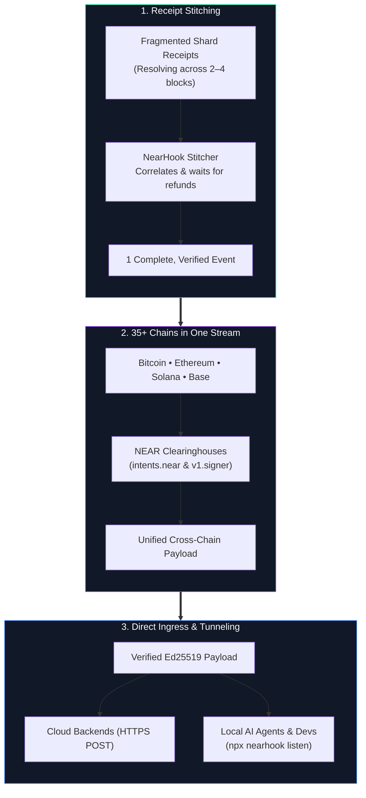
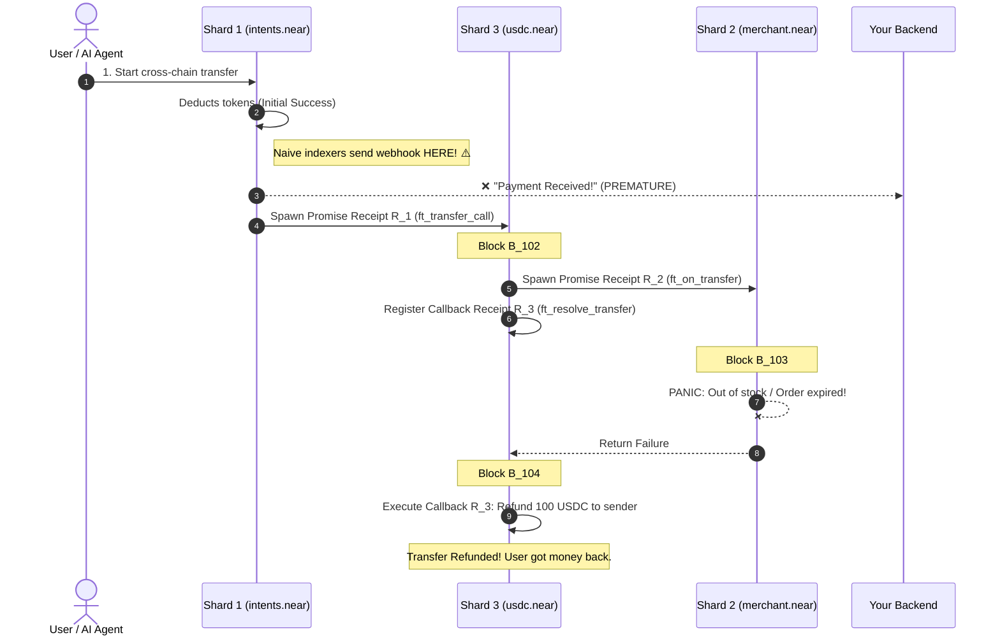
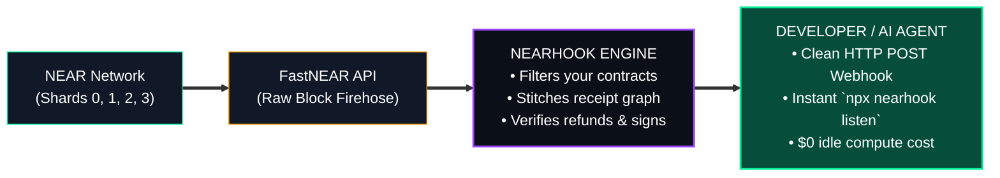
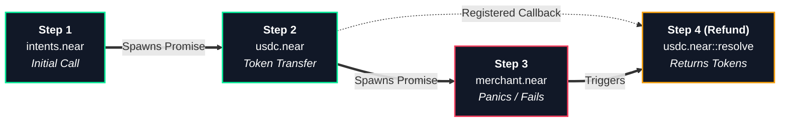
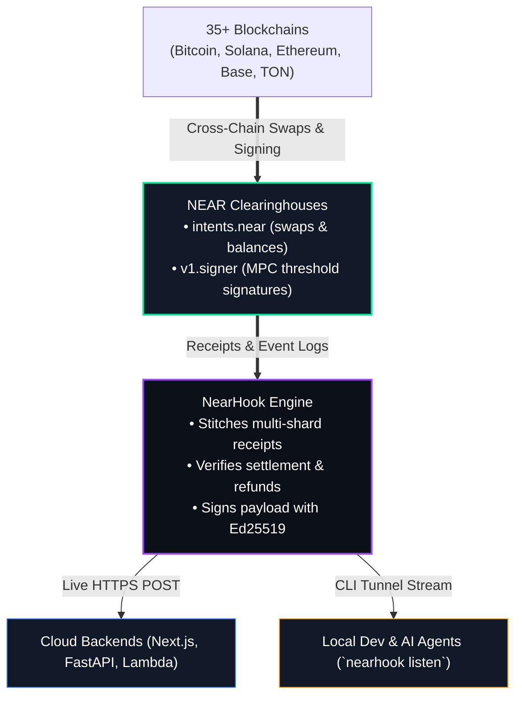
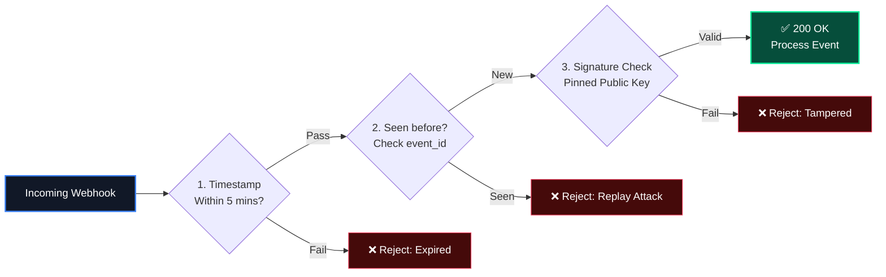
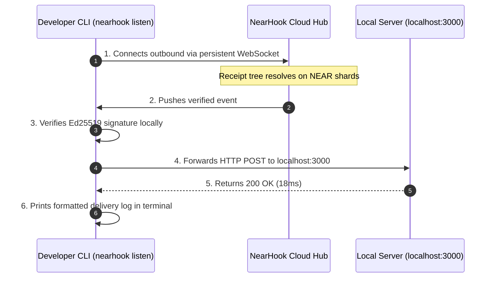

# NearHook: Asynchronous Receipt Stitching & Cross-Chain Event Ingress for NEAR Protocol

**Whitepaper** • Version 2.4 • November 2026  

---

## 1. What is NearHook?

> **NearHook stitches NEAR’s asynchronous receipts into signed webhooks across 35+ chains (Bitcoin, Ethereum, Solana, and beyond). It streams verified cross-chain events straight to cloud backends or local AI agents via a zero-config CLI tunnel.**

To understand why this is a major breakthrough, consider its three pillars:



### Pillar 1: What is "Receipt Stitching"?
On NEAR, a single transaction doesn't execute in one atomic step. It fragments into multiple asynchronous pieces called **Receipts** that jump across shards over 2 to 4+ blocks. 

**"Stitching"** means NearHook acts as the puzzle assembler: it tracks the parent receipt, follows every child promise, monitors refund callbacks, and holds the event in memory until the whole tree completes. It stitches the fragmented pieces into a single, cohesive, finalized event.

### Pillar 2: How Does it Cover 35+ Chains?
NEAR is an omnichain clearinghouse:
* **NEAR Intents (`intents.near`):** Swaps and bridges tokens across 35+ networks (Bitcoin, Solana, Ethereum, Dogecoin, Base, Arbitrum) using native Omni-Bridge contracts.
* **Chain Signatures (`v1.signer`):** Uses decentralized Multi-Party Computation (MPC) to sign transactions for foreign blockchains directly from NEAR.

Instead of paying for and maintaining 35 separate blockchain indexers, NearHook indexes NEAR's clearinghouse contracts, turning multi-chain settlements into **one unified webhook pipe**.

### Pillar 3: Streaming to Cloud Backends & Local AI Agents
* **Production Cloud:** Dispatches signed HTTPS POST webhooks to your serverless functions or microservices (Next.js, FastAPI, AWS Lambda).
* **Local Development & AI Agents:** Running `npx nearhook listen` streams live verified events straight into your local server (`localhost:3000`) or local AI agent runtime (ElizaOS, LangChain) with zero setup and no ngrok.
* **Scale-to-Zero:** AI agents sleep at **$0 idle compute cost** and wake up in milliseconds only when a verified event arrives.

---

## 2. The Problem: The "Early Webhook" Trap

On single-block blockchains (Ethereum, Solana), transactions finish immediately. 

On NEAR's Nightshade sharded architecture, transactions take **2 to 4 blocks** to complete. If an indexer fires a webhook on Block 1, your backend acts on partial state before downstream calls have finished:



**The consequence:** If you fulfilled an order on Block 1, you gave away goods for free because the payment was refunded on Block 4.

---

## 3. Why Can't You Just Use NEAR Lake or FastNEAR Directly?

A common question is: *"If NEAR Lake and FastNEAR already exist, why can't developers just consume them directly?"*

Here is why:

### 1. Smart Contracts Cannot Send Webhooks
Smart contracts execute inside a WebAssembly (Wasm) sandbox on validator nodes. They are strictly prohibited from opening outbound TCP sockets, making HTTP POST requests, or calling external APIs. The blockchain cannot push events to you—an off-chain bridge must ingest and deliver them.

### 2. Why Not NEAR Lake?
* **High Latency:** NEAR Lake writes block files to **AWS S3 buckets**. Polling S3 introduces a **1.5 to 3+ second delay** after block inclusion.
* **Heavyweight & Expensive:** Consuming NEAR Lake requires AWS credentials, S3 SDKs, and running a persistent Rust/Python container parsing every block on the network. This costs **$50–$200+/month** in cloud compute—unviable for developers who just need a simple webhook for their own contract.
* **No Optimistic Blocks:** NEAR Lake only archives finalized blocks.

### 3. Why Not FastNEAR Directly?
FastNEAR provides an ultra-low latency HTTP API (`/v0/block_opt/{height}`). NearHook uses FastNEAR internally for this reason. But consuming FastNEAR directly as an application developer presents major hurdles:

* **Raw Network Dump (Not a Webhook):** FastNEAR is a pull-based query API, not an event-push service. Querying a block returns a **massive 2MB–5MB JSON dump of every transaction, receipt, and execution across all shards on the entire network**. You would have to write custom code to filter out 99.9% of irrelevant data.
* **FastNEAR Does NOT Stitch Receipts:** FastNEAR gives you a raw snapshot of what happened in Block 101. It will **not** correlate that Block 101's receipt spawns a promise in Block 102, panics in Block 103, and refunds in Block 104. If you use FastNEAR directly, **you must build your own distributed receipt tracker and state machine in Redis/PostgreSQL**.
* **Pull vs. Push (Scale-to-Zero):** Serverless backends (Vercel, AWS Lambda) and autonomous AI agents need to sleep at **$0 idle cost** and wake up for 50ms when an HTTP `POST` arrives. They cannot run a continuous 24/7 `while(true)` polling loop against FastNEAR without burning continuous compute bills.
* **Cannot Reach `localhost:3000`:** FastNEAR cannot stream events into your laptop behind Wi-Fi routers and NAT firewalls. Testing locally requires paying for and configuring ngrok or cloud proxies.



> **The Analogy:** FastNEAR is the **firehose of raw municipal water** (high-speed raw data for the entire network). NearHook is the **smart filtration system and kitchen tap**: it filters the noise, tracks the exact transaction you care about, ensures it wasn't refunded, signs it, and pours it straight into your server or local laptop.

---

## 4. How NearHook Stitches Receipts & Detects Refunds

NearHook waits until the entire receipt graph finishes before dispatching:



### 1. Tracks All Related Receipts
NearHook connects parent receipts to child calls and callbacks. It only marks a transaction ready when every child and callback has completed.

### 2. Understands Business Outcomes (Refunds vs Success)
When a contract callback like `ft_resolve_transfer` handles a failure and refunds tokens, NearHook accurately reports the business status as `REFUNDED` instead of reporting a false success or crashing your integration.

---

## 5. Multi-Chain Settlement in One Webhook

Instead of managing node providers and indexers across 35+ chains, NearHook translates NEAR's cross-chain contracts into clear, human-readable events:



* **NEAR Intents (`intents.near`):** Parses NEP-297 `token_diff` logs, turning raw addresses like `nep141:sol.omft.near` into clean metadata (`SOLANA`, `15.0 SOL`).
* **Chain Signatures (`v1.signer`):** Correlates sign requests with asynchronous MPC callbacks, delivering ready-to-broadcast foreign signatures.

---

## 6. Security: Verifying Incoming Webhooks

NearHook secures every delivery using native Ed25519 cryptographic signatures:



1. **Ed25519 Signatures:** Payloads are signed with the relayer's private key. Your server checks it against NearHook's pinned public key.
2. **Replay Protection:** Unique `X-NearHook-Id` headers allow your server to reject duplicate requests sent within the 5-minute window.

---

## 7. Zero-Config Local Tunneling (`nearhook listen`)

Developers and AI engineers can develop locally without port-forwarding or paying for ngrok:

```bash
npx nearhook listen --account "*.myapp.near" --forward http://localhost:3000/api/webhook
```



* **Firewall Traversal:** Uses an outbound WebSocket connection—no router changes or static IPs needed.
* **1-Click Free Replay:** If your local server crashes during testing, click **Replay** in the dashboard to re-send the exact payload without paying gas on NEAR.

---

## 8. Example Webhook Payload

When a cross-chain swap or intent settles on NEAR, your backend or AI agent receives this clean JSON payload:

```json
{
  "event_id": "evt_99214a8b3c",
  "event_type": "INTENT_SETTLED",
  "settlement": {
    "tx_hash": "8kL9v7m2xPqR4tY9uW1zK3nM5pQ7vB2cX4zL9mN1pQr",
    "blocks_spanned": 3,
    "status": "CONFIRMED"
  },
  "route": {
    "source_chain": "SOLANA",
    "source_amount": "15.0 SOL",
    "destination_chain": "BITCOIN",
    "destination_amount": "0.0285 BTC",
    "destination_address": "bc1qxy2kgdygjrsqtzq2n0yrf2493p83kkfjhx0wlh"
  },
  "attestation": {
    "relayer_public_key": "ed25519:3N8xZ2LkdIwHu7ix9pLm...",
    "timestamp": 1762849200
  }
}
```

---

## 9. Summary: FastNEAR Directly vs. With NearHook

| Capability | Consuming FastNEAR Directly | Consuming NearHook |
| :--- | :--- | :--- |
| **Data Format** | Raw 5MB network dump of every block | Clean, filtered JSON payload for *your* contract |
| **Delivery Mechanism** | You must run continuous `while(true)` polling | Standard **HTTP POST Webhook** pushed to you |
| **Receipt Stitching** | **None.** You must write code to track multi-block receipts | **Automatic.** NearHook holds dispatch until terminal settlement |
| **Refund Detection** | You must parse raw contract callbacks manually | Webhook explicitly says `CONFIRMED` vs `REFUNDED` |
| **Compute Cost** | Pay 24/7 for servers running continuous polling loops | **$0 idle cost.** Serverless & agents wake up only when needed |
| **Local Dev (`localhost:3000`)**| Impossible without ngrok or custom proxies | **Built-in tunnel (`npx nearhook listen`)** |
| **Historical Replay** | Re-run on-chain transactions and pay gas | **1-click free replay** from durable event logs |
| **Cryptographic Security** | Raw unsigned HTTP data | Signed with **Ed25519** with replay protection |
