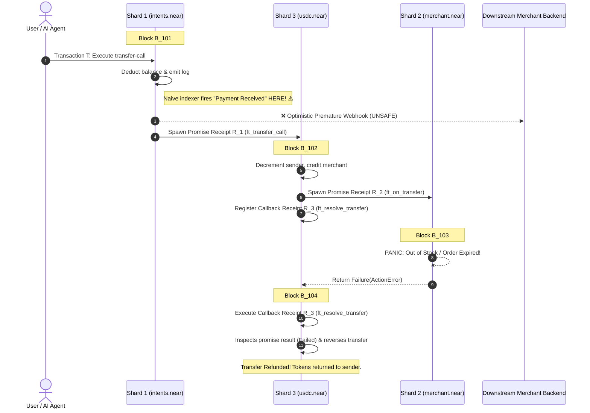
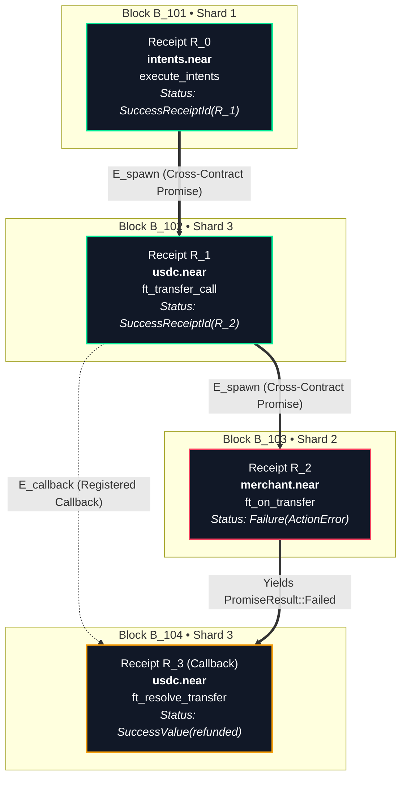
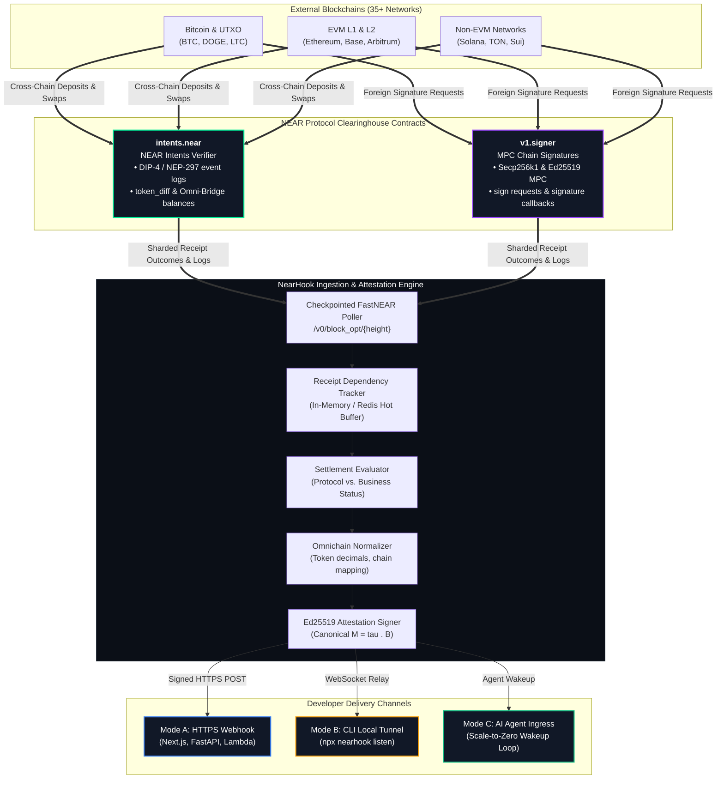
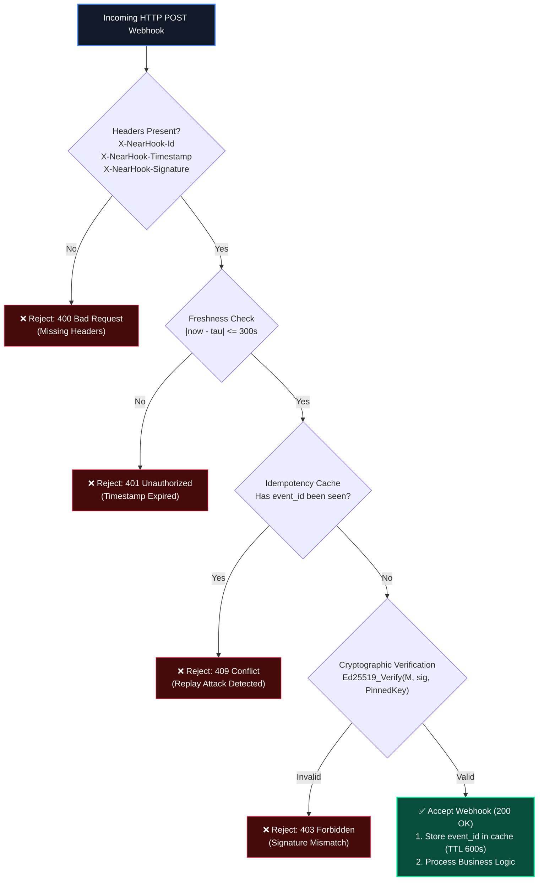
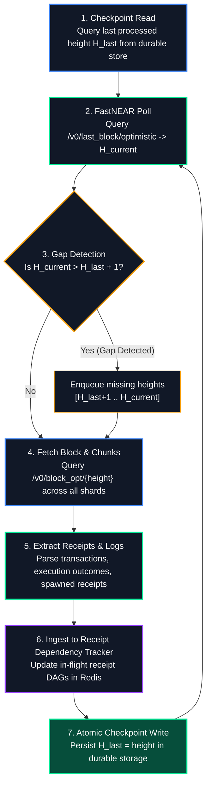
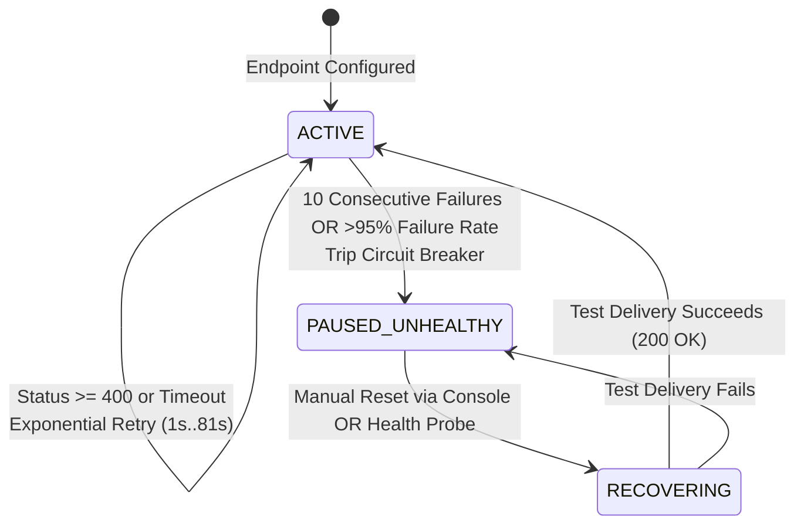
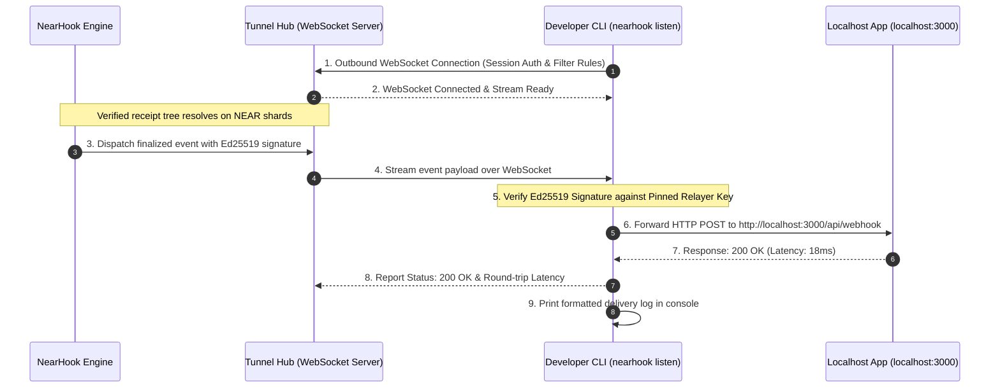

# NearHook: Asynchronous Receipt-Aware Event Delivery, Omnichain Clearinghouse Ingress, and Local Tunneling for NEAR Protocol

**Technical Whitepaper**  
**Version:** 2.0.0 (Architecture Revision)  
**Date:** November 2026  
**Category:** Developer Infrastructure / Event Ingress / NEAR Protocol Tooling  
**Status:** Technical Specification & System Design  

---

## Abstract

Modern decentralized applications, backend microservices, and autonomous software agents operate as event-driven state machines: they observe state transitions on-chain, execute business logic off-chain, and submit signed transactions back to the network. While NEAR Protocol provides robust primitives for transaction submission and threshold signing—such as native Function Call Access Keys, hierarchical sub-accounts, NEAR Intents (`intents.near`), and Multi-Party Computation (MPC) Chain Signatures (`v1.signer`)—consuming verified state changes on NEAR poses fundamental challenges due to **Nightshade asynchronous sharding**.

On NEAR, a single transaction decomposes into an asynchronous tree of execution receipts (`Receipt`) that resolve across multiple shards over 2 to 4+ consecutive blocks. Naive indexers and RPC pollers that trigger callbacks upon root transaction inclusion suffer from **Optimistic Settlement Vulnerabilities**: a parent receipt succeeds at block $B_t$, but a downstream cross-contract promise fails at block $B_{t+1}$, causing a contract callback to execute a refund or state rollback at block $B_{t+2}$.

This whitepaper presents **NearHook**, a developer-first, receipt-aware event delivery gateway and local tunneling tool for NEAR Protocol. NearHook addresses these challenges through four architectural components:

1. **Receipt Dependency Tracking & Settlement Evaluation:** A stateful receipt tracker that follows asynchronous promise delegations, correlates contract callbacks, and evaluates domain-level business outcomes rather than naively treating intermediate receipt outcomes as final settlement.
2. **NEAR Clearinghouse Event Ingress:** Normalized parsing for cross-chain activity mediated by NEAR's core clearinghouses (`intents.near` NEP-297/DIP-4 intent logs and `v1.signer` MPC signing requests and callbacks).
3. **Cryptographically Attested Delivery:** Asymmetric Ed25519 signed payloads with pinned relayer public keys and event-ID deduplication for replay protection.
4. **Durable Ingestion & Developer Tooling:** A checkpointed block-polling worker, an exponential backoff delivery queue, durable PostgreSQL `JSONB` logs for gas-free historical replay, and zero-config local tunneling (`npx nearhook listen`).

---

## 1. Motivation & Problem Statement

### 1.1 The Asynchronous Ingestion Challenge on NEAR

In monolithic or single-slot atomic blockchains (e.g., Ethereum, Solana), transaction execution is all-or-nothing within a single block height $B_t$. If any internal instruction reverts, the entire call stack unwinds atomically at $B_t$.

NEAR Protocol employs **Nightshade Sharding**, partitioning state across multiple independent shards ($S_0, S_1, \dots, S_k$). When an execution touches contracts on different shards, NEAR decouples transaction inclusion from cross-contract execution through asynchronous message packets called **Receipts**:



### 1.2 The Optimistic Settlement Vulnerability

Downstream applications, payment processors, and automated agents frequently monitor blockchain state by polling RPC endpoints (e.g. `tx` or `EXPERIMENTAL_tx_status`) or subscribing to single-block log streams. 

If an ingestion listener observes `Receipt R_0: Success` at Block $B_{101}$ and immediately fires a webhook (`"Payment Received"`), the downstream service acts on unfinalized, optimistic state. Two blocks later, the inner promise fails and the refund callback executes. The merchant has released goods or credited user accounts for a payment that was ultimately rolled back.

### 1.3 Why Existing Ingestion Patterns Are Insufficient

1. **NEAR Lake Framework:** Designed for archival data pipelines. It streams raw `StreamerMessage` objects containing every chunk, receipt, and block across the entire network. Operating a Lake consumer requires provisioning AWS credentials, maintaining persistent S3 readers, and parsing gigabytes of raw data per hour—an excessive footprint for a team merely needing notifications when their contract emits an event.
2. **Naive RPC Polling:** Querying `EXPERIMENTAL_tx_status` in a `while(true)` loop burns RPC compute units, introduces multi-second polling latency, and forces serverless or agent functions to stay awake 24/7 rather than scaling to zero.
3. **Generic Webhook Gateways:** Multi-chain webhook providers designed for EVM or Solana assume flat 32-byte hex addresses and atomic execution. They do not track cross-shard receipt graphs, callback promise dependencies, or NEAR's hierarchical account namespaces (`*.near`).

---

## 2. Receipt Dependency Tracking & Settlement Semantics

### 2.1 The Limitations of Naive Set-Difference Completeness

A naive formulation of receipt completion posits that a transaction $T$ is complete when all spawned receipts equal all observed executions:

$$\Delta(T) = S_{\text{spawned}}(T) \setminus S_{\text{executed}}(T) = \emptyset$$

**Why this invariant alone is insufficient:**
1. **Discovery Latency:** At Block $B_{101}$, only $R_0$ has executed. It spawned $R_1$. However, until $R_1$ actually executes at Block $B_{102}$, the indexer has no knowledge that $R_1$ will subsequently spawn $R_2$ and $R_3$. An out-of-order block ingestion or premature check would observe $\Delta(T) = \emptyset$ simply because child dependencies have not yet been discovered.
2. **Indexer Gaps & Restarts:** If the ingestion worker restarts or processes shards asynchronously, in-memory sets can momentarily appear empty or lose tracking state without guaranteeing that the underlying receipt DAG has reached terminal execution.
3. **Network Boundary Ambiguity:** Without tracking explicit block sequence numbers and checkpoint confirmations from the underlying blockchain, an empty diff merely indicates "no currently known outstanding receipts," not guaranteed protocol finality.

### 2.2 Formalizing the Receipt Dependency Graph

NearHook models a transaction execution as a dynamic Directed Acyclic Graph (DAG) with explicit dependency typing:

$$G_T = (V_T, E_T)$$

* **Vertices ($V_T$):** Each vertex $v \in V_T$ represents an execution receipt outcome (`ReceiptExecution`), identified by its unique `ReceiptId`.
* **Edges ($E_T$):** Directed edges $(u, v) \in E_T$ represent causal relationships:
  * **Promise Spawns ($E_{\text{spawn}}$):** Parent receipt $u$ initiates child receipt $v$ via `ExecutionOutcome.receipt_ids`.
  * **Callback Dependencies ($E_{\text{callback}}$):** Receipt $v$ is a callback scheduled to execute only after receipt $u$ yields a terminal `PromiseResult`.



A transaction $T$ is defined as **Terminally Resolved** if and only if:
1. The root receipt $v_{\text{root}}$ has executed.
2. Every discovered vertex $v \in V_T$ has an associated terminal `ExecutionStatus` (`SuccessValue`, `SuccessReceiptId`, or `Failure`).
3. For every vertex $u$ with outstanding child promises or callbacks $(u, w) \in E_T$, vertex $w$ has been observed and processed.
4. The block height $H(v)$ for all $v \in V_T$ is confirmed against the indexer's contiguous, gap-free block ingestion sequence.

### 2.3 Application-Level Settlement vs. Naive Failure Classification

A critical flaw in naive indexers is assuming that *any* receipt failure implies the entire transaction failed:

$$\exists v \in V_T : \text{status}(v) = \text{Failure} \overset{?}{\implies} \text{Transaction Failed}$$

In NEAR's asynchronous contract model, this assumption is **incorrect**. Smart contracts deliberately utilize callback promises to handle downstream errors gracefully:

* **Example: NEP-141 `ft_transfer_call`:**
  When a user calls `ft_transfer_call`, the token contract calls `ft_on_transfer` on the recipient contract and registers `ft_resolve_transfer` as a callback.
  If the recipient contract panics (`Failure`), the callback `ft_resolve_transfer` executes successfully, calculates unused tokens via `env::promise_result(0)`, restores the sender's balance, and returns the refunded amount.
  The callback receipt itself succeeds (`SuccessValue`).

**Settlement Evaluation Engine:**
NearHook evaluates transaction outcomes along two distinct axes:
1. **Protocol Execution Status:** Did the receipt tree resolve without unhandled runtime panics?
2. **Business Settlement Status:** What was the domain outcome of the specific monitored contract?

For monitored standards (such as NEP-141 / NEP-245 transfers and `intents.near` settlements), NearHook inspects:
* The execution outcome of the terminal resolver callback (`ft_resolve_transfer`).
* Structured event logs (`NEP-297` standard events) emitted by the primary contracts.
* Return values of terminal receipts (`SuccessValue` payload).

This allows NearHook to distinguish between a payment that was **Confirmed**, a payment that was **Handled & Refunded**, and a transaction that experienced an **Unhandled Panic**.

---

## 3. NEAR Clearinghouse Ingress: Intents & Chain Signatures

### 3.1 Scoping the Omnichain Ingress Claims

NearHook does **not** claim to replace full-node indexers across 35+ external blockchains. It cannot observe arbitrary, unbridged transactions taking place entirely on Ethereum, Solana, or Bitcoin without external indexing infrastructure.

Instead, NearHook provides dedicated ingress for **cross-chain activity that settles through NEAR's native clearinghouses**:

1. **NEAR Intents (`intents.near`):** Multi-chain atomic swaps, cross-chain deposits, and withdrawals clearing through Omni-Bridge (`*.omft.near`) tokens on NEAR.
2. **Chain Signatures (`v1.signer`):** Multi-Party Computation (MPC) signing requests where NEAR contracts derive foreign keys and construct valid signatures for Bitcoin, Ethereum, Solana, and other external networks.

NearHook observes and normalizes the **NEAR-side state transitions** of these clearinghouses, delivering structured events when intents clear or when threshold signatures are generated.



### 3.2 NEP-297 & DIP-4 Event Normalization

Smart contracts on NEAR emit structured logs adhering to the **NEP-297 Event Standard**, prefixed with `EVENT_JSON:`.
`intents.near` emits events using the `dip4` standard identifier:

```json
EVENT_JSON:{
  "standard": "dip4",
  "version": "0.3.0",
  "event": "token_diff",
  "data": [
    {
      "account_id": "solver-01.near",
      "intent_hash": "5GpL6PsUQVHFYAk5FWEwBUaEQqcZkc2SjTvPYHgHAnx8",
      "diff": {
        "nep141:sol.omft.near": "-15000000000",
        "nep141:btc.omft.near": "2850000"
      }
    }
  ]
}
```

NearHook decodes raw Omni-Bridge contract identifiers into canonical asset metadata:
* `nep141:sol.omft.near` $\longrightarrow$ Asset: `SOL`, Decimals: 9, Chain: `SOLANA`, Formatted: `-15.0 SOL`
* `nep141:btc.omft.near` $\longrightarrow$ Asset: `BTC`, Decimals: 8, Chain: `BITCOIN`, Formatted: `+0.0285 BTC`
* `nep141:base-0x833589fcd6edb6e08f4c7c32d4f71b54bda02913.omft.near` $\longrightarrow$ Asset: `USDC`, Decimals: 6, Chain: `BASE`

### 3.3 Chain Signatures MPC Parsing (`v1.signer`)

When a contract on NEAR requests an external signature, it calls `sign` on `v1.signer`. The decentralized MPC node network generates the threshold signature across subsequent blocks and emits the resulting `big_r` and `s` signature elements in a callback receipt.

NearHook correlates the calling receipt with the asynchronous MPC callback, delivering the ready-to-broadcast foreign signature to the subscriber.

---

## 4. Cryptographic Security & Attestation

Because webhook deliveries can trigger financial transfers, inventory release, or autonomous agent trades, endpoints must verify the authenticity, integrity, and freshness of incoming requests.

### 4.1 Threat Model & Attack Vectors

| Attack Vector | Vulnerability | NearHook Defense |
| :--- | :--- | :--- |
| **Payload Tampering** | Attacker modifies webhook body in transit | Ed25519 asymmetric signature over canonical pre-image |
| **Relayer Spoofing** | Attacker injects their own public key in HTTP headers | Client-side **public key pinning**; dynamic headers ignored |
| **Replay Attacks** | Attacker resends valid historic payload within timestamp window | **Event-ID deduplication cache** required on receiver |
| **Stale Delivery** | Attacker holds and delays valid webhook | Strict timestamp expiration window ($|\tau - \text{now}| \le 300\text{s}$) |

### 4.2 Asymmetric Ed25519 Signing

NearHook utilizes asymmetric Ed25519 signatures, matching NEAR Protocol's native cryptographic curve:

1. **Canonical Signing Pre-Image:**
   Given the Unix epoch timestamp in seconds ($\tau$) and the raw UTF-8 serialized JSON payload ($B$), the relayer constructs:
   $$M = \tau \parallel \text{"."} \parallel B$$

2. **Signature Generation:**
   $$\sigma = \text{Ed25519\_Sign}_{sk_{\text{relayer}}}(M)$$

3. **HTTP Delivery Headers:**
   * `X-NearHook-Id: evt_01h8x4a9k7z2...` (Unique event ID for deduplication)
   * `X-NearHook-Timestamp: 1762849200` (Unix epoch seconds)
   * `X-NearHook-Signature: ed25519:<hex_encoded_signature>`

### 4.3 Secure Receiver Verification Protocol

Receiving endpoints must implement the verification sequence depicted in Figure 3 to guarantee freshness, replay immunity, and authenticity:



```typescript
import { ed25519 } from '@noble/curves/ed25519';

export interface VerifyOptions {
  headers: Record<string, string | undefined>;
  rawBody: string;
  pinnedPublicKeyHex: string; // Pinned public key from dashboard / env
  idempotencyStore: { has(id: string): Promise<boolean>; set(id: string): Promise<void> };
  toleranceSeconds?: number;
}

export async function verifyNearHookWebhook(options: VerifyOptions): Promise<{ valid: boolean; reason?: string }> {
  const { headers, rawBody, pinnedPublicKeyHex, idempotencyStore, toleranceSeconds = 300 } = options;

  const eventId = headers['x-nearhook-id'];
  const timestampStr = headers['x-nearhook-timestamp'];
  const signatureHeader = headers['x-nearhook-signature'];

  if (!eventId || !timestampStr || !signatureHeader) {
    return { valid: false, reason: 'Missing required X-NearHook headers' };
  }

  // 1. Timestamp Freshness Window
  const timestamp = parseInt(timestampStr, 10);
  const now = Math.floor(Date.now() / 1000);
  if (isNaN(timestamp) || Math.abs(now - timestamp) > toleranceSeconds) {
    return { valid: false, reason: 'Webhook timestamp outside tolerance window' };
  }

  // 2. Replay Protection: Event ID Idempotency Check
  if (await idempotencyStore.has(eventId)) {
    return { valid: false, reason: 'Duplicate event ID (replay attack rejected)' };
  }

  // 3. Signature Verification using PINNED Public Key
  const signatureHex = signatureHeader.replace(/^ed25519:/, '');
  const messageBytes = new TextEncoder().encode(`${timestamp}.${rawBody}`);

  try {
    const isValid = ed25519.verify(signatureHex, messageBytes, pinnedPublicKeyHex);
    if (!isValid) {
      return { valid: false, reason: 'Cryptographic signature mismatch' };
    }
  } catch (err) {
    return { valid: false, reason: 'Invalid signature encoding or format' };
  }

  // Record event ID to prevent replays within the timestamp window
  await idempotencyStore.set(eventId);
  return { valid: true };
}
```

---

## 5. Ingestion Engine & Storage Architecture

### 5.1 Data Ingestion: Checkpointed FastNEAR Poller

FastNEAR’s NEAR Data API provides low-latency HTTP access to recent finalized and optimistic blocks. FastNEAR is an **HTTP query API, not a persistent streaming socket**. 

NearHook implements an ingestion worker with deterministic checkpointing:



**Fault-Tolerance & Reorganization Handling:**
* **Contiguous Height Enforcement:** The worker never advances its checkpoint until all shard chunks for height $H$ are successfully processed.
* **Optimistic vs. Final Confirmation:** NearHook allows users to subscribe at two finality levels:
  * `Optimistic` (default): Emitted as soon as cross-shard receipt trees satisfy terminal resolution on optimistic blocks (~1.0s latency).
  * `Final`: Emitted only after the terminal block height receives BFT consensus finality (Doomslug 2-block confirmation).

### 5.2 Two-Tier Storage Architecture

NearHook separates ephemeral receipt correlation from durable delivery logging:

1. **Ephemeral Hot Memory (Redis):**
   * Buffers in-flight receipts during the multi-block resolution window:
     * `nearhook:tx:{hash}:tracker`: Hash storing root transaction metadata, discovered receipts, and callback dependencies.
     * `nearhook:tx:{hash}:nodes`: Hash mapping `ReceiptId` to serialized `ExecutionOutcomeNode`.
   * **Receipt Expiration & Fallback:** Ephemeral state has a configurable TTL (default 120s). Transactions spanning unusual latency windows are persisted to durable storage before hot memory expires.

2. **Durable Store (PostgreSQL / NeonDB):**
   * `subscriptions`: Wildcard routing rules (`*.near`, `intents.near`), chain filters, target URLs, and circuit breaker health.
   * `deliveries`: Stitched canonical JSON payloads stored in a `JSONB` column, HTTP status codes, latencies, and attempt counts.
   * **1-Click Historical Replay:** Allows developers to re-dispatch any previous webhook payload to local or cloud endpoints without on-chain re-execution.

### 5.3 Delivery Pipeline & Circuit Breaker

* **Retry Policy:** Deliveries returning status $\ge 400$ or timing out ($>5000\text{ms}$) are re-enqueued with jittered exponential backoff (1s, 3s, 9s, 27s, 81s).
* **Circuit Breaker:** If an endpoint fails 10 consecutive deliveries or exhibits a $>95\%$ failure rate over 50 attempts, its status is transitioned to `PAUSED_UNHEALTHY` to protect relayer network resources.



---

## 6. Local Development & Tunneling (`nearhook listen`)

Developing webhook consumers behind corporate firewalls or NAT typically requires running third-party reverse proxies (such as ngrok or Cloudflare Tunnels).

NearHook provides an integrated local tunneling workflow:



* **Zero-Config NAT Traversal:** Because the CLI opens an *outbound* WebSocket connection to the NearHook Tunnel Hub, local developer machines require no open inbound ports or static IPs.
* **Local Attestation Verification:** The CLI performs Ed25519 signature checks locally before forwarding payloads to `localhost`, ensuring that local handlers only execute verified events.

---

## 7. Canonical Webhook Payload Specification

Below is the formal JSON payload produced by NearHook upon resolving a cross-chain `SOL -> BTC` intent settlement:

```json
{
  "event_id": "evt_01h8x4a9k7z2m3n4p5q6r7s8t9",
  "event_type": "INTENT_SETTLEMENT_COMPLETED",
  "finality": "OPTIMISTIC",
  "subscription": {
    "id": "sub_99214a",
    "account_filter": "intents.near",
    "chain_filter": ["SOLANA", "BITCOIN"]
  },
  "settlement": {
    "origin_tx_hash": "8kL9v7m2xPqR4tY9uW1zK3nM5pQ7vB2cX4zL9mN1pQr",
    "root_receipt_id": "4fG1b89aBcDeF2gH3iJ4kL5mN6oP7qR8sT9uV0wXyZ1",
    "start_block_height": 142890120,
    "final_block_height": 142890122,
    "blocks_spanned": 3,
    "total_gas_burnt_tgas": 14.8,
    "protocol_status": "SUCCESS",
    "business_status": "CONFIRMED"
  },
  "receipt_tree": {
    "root_receipt_id": "4fG1b89aBcDeF2gH3iJ4kL5mN6oP7qR8sT9uV0wXyZ1",
    "nodes": [
      {
        "receipt_id": "4fG1b89aBcDeF2gH3iJ4kL5mN6oP7qR8sT9uV0wXyZ1",
        "block_height": 142890120,
        "shard_id": 1,
        "receiver_id": "intents.near",
        "method": "execute_intents",
        "status": "SuccessReceiptId"
      },
      {
        "receipt_id": "9aBc2d3eF4gH5iJ6kL7mN8oP9qR0sT1uV2wX3yZ4LmN4",
        "block_height": 142890121,
        "shard_id": 3,
        "receiver_id": "btc.omft.near",
        "method": "ft_withdraw",
        "status": "SuccessReceiptId"
      },
      {
        "receipt_id": "7xKp93m2L1aB4c5d6e7f8g9h0i1j2k3l4m5n6o7pQrS8",
        "block_height": 142890122,
        "shard_id": 0,
        "receiver_id": "v1.signer",
        "method": "sign",
        "status": "SuccessValue"
      }
    ],
    "dependencies": [
      { "parent": "4fG1b8...XyZ1", "child": "9aBc2d...LmN4", "type": "PROMISE" },
      { "parent": "9aBc2d...LmN4", "child": "7xKp93...QrS8", "type": "PROMISE" }
    ]
  },
  "omnichain_settlement": {
    "clearinghouse": "intents.near",
    "standard": "NEP-297",
    "standard_version": "dip4:0.3.0",
    "source_chain": "SOLANA",
    "source_token": "nep141:sol.omft.near",
    "source_amount_raw": "15000000000",
    "source_amount_formatted": "15.0 SOL",
    "destination_chain": "BITCOIN",
    "destination_token": "nep141:btc.omft.near",
    "destination_amount_raw": "2850000",
    "destination_amount_formatted": "0.0285 BTC",
    "destination_address": "bc1qxy2kgdygjrsqtzq2n0yrf2493p83kkfjhx0wlh",
    "solver_account_id": "wintermute.solver.near"
  },
  "attestation": {
    "relayer_public_key": "ed25519:3N8xZ2LkdIwHu7ix9pLmQ4vB7nM2kP8xR1tY5uW9zQ2...",
    "timestamp": 1762849200
  }
}
```

---

## 8. Latency Design Targets & Proposed Benchmarking Methodology

Previous drafts of this architecture cited preliminary latency figures without an accompanying benchmark methodology. This revision explicitly distinguishes **architectural design targets** from **empirically measured results**.

### 8.1 Architectural Latency Targets

NearHook is architected toward the following performance profile:

| Stage | Mechanism | Target Latency |
| :--- | :--- | :--- |
| **Block Polling & Extraction** | FastNEAR HTTP polling (1s interval) | $200\text{ms} - 500\text{ms}$ (from block availability) |
| **Receipt Tracking & Graph Update** | In-Memory / Redis Hash operations | $<5\text{ms}$ per chunk |
| **Terminal Settlement Check** | Pure DAG dependency evaluator | $<1\text{ms}$ |
| **Ed25519 Relayer Signing** | `@noble/curves/ed25519` | $<0.5\text{ms}$ |
| **Outbound Webhook Dispatch** | Node.js HTTP client / WebSocket stream | $15\text{ms} - 50\text{ms}$ (network dependent) |

### 8.2 Empirical Benchmarking Plan

To substantiate these targets, a formal benchmark suite will be executed and documented:

1. **Synthetic Multi-Shard Test Harness:** A reproducible load generator creating 100, 500, and 1,000 concurrent multi-shard cross-contract transaction receipts spanning 2–4 blocks.
2. **Metrics Measured:**
   * $T_{\text{block-to-ingest}}$: Time from block timestamp to ingestion worker receipt.
   * $T_{\text{resolve}}$: Time from root receipt execution to terminal callback processing.
   * $T_{\text{dispatch}}$: Time from terminal resolution to HTTP POST completion.
   * P50, P95, and P99 latency percentiles across 10,000 consecutive test transactions.
   * Worker recovery time following simulated ingestion downtime (checkpoint catch-up rate).

Results from this harness will be published in a companion technical evaluation report.

---

## 9. Conclusion

Consuming state transitions on NEAR Protocol requires addressing the asynchronous realities of Nightshade sharding. Naive indexers that treat root transaction inclusion as final settlement expose developers to severe Optimistic Settlement Vulnerabilities.

**NearHook** provides a robust, developer-first event delivery infrastructure:
* It models the full receipt dependency graph, distinguishing technical receipt failures from deliberate contract refund callbacks.
* It provides structured ingress for NEAR's multi-chain clearinghouses (`intents.near` and `v1.signer`).
* It guarantees cryptographic delivery through Ed25519 signatures with public key pinning and replay deduplication.
* It simplifies local development through zero-config CLI tunneling and 1-click historical replay.

---

## References

1. Skidanov, A., & Polosukhin, I. (2019). *Nightshade: Consensus and sharding specification for NEAR Protocol*. NEAR Research.
2. NEAR Protocol Documentation. *Receipts and Cross-Contract Calls Architecture*. https://docs.near.org/concepts/basics/transactions/overview
3. NEAR Enhancement Proposals. *NEP-141: Fungible Token Standard*. https://github.com/near/NEPs/blob/master/neps/nep-0141.md
4. NEAR Enhancement Proposals. *NEP-297: Event Standard Specification*. https://github.com/near/NEPs/blob/master/neps/nep-0297.md
5. Decentralized Intent Protocol. *DIP-4: Multi-Token Event Standards for intents.near*. https://github.com/defuse-protocol/defuse-contracts
6. FastNEAR. *NEARDATA API Documentation*. https://docs.fastnear.com
7. Bernstein, D. J., Duif, N., Lange, T., Schwabe, P., & Yang, B. Y. (2012). *High-speed high-security signatures*. Journal of Cryptographic Engineering, 2(2), 77-89.
